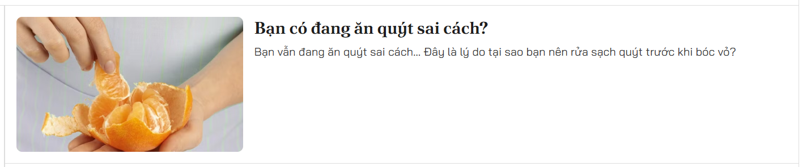
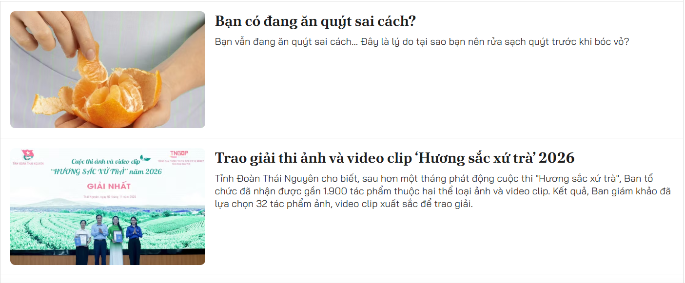
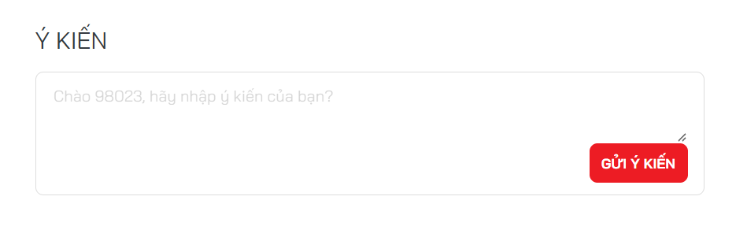
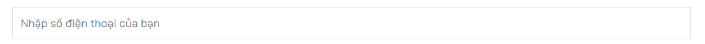
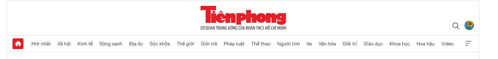
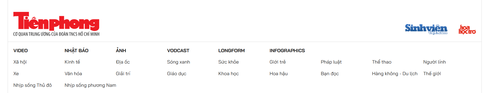

Nhóm components/articles/ — các components cho articles

| File           | Ý nghĩa                            |
| -------------- |------------------------------------|
| ArticleCard.tsx     | ô article cơ bản                   |                               
| ArticleList.tsx    | danh sách article                  |
| CompactArticleList.tsx  | danh sách article gom cụm          |
| FeaturedArticleList.tsx    | danh sách article theo hướng ngang |
| MainArticleCard.tsx    | ô article lớn nhất                 |
| SubArticleCard.tsx   | các ô article bé hơn               |

# ArticleCard

# ArticleList

# CompactArticleList

# FeaturedArticleList

# MainArticleCard

# SubArticleCard

hoặc

Nhóm components/comments/ — các components cho comments

| File                | Ý nghĩa               |
| ------------------- |-----------------------|
| CommentItem.tsx    | 1 thẻ comment         |
| CommentSection.tsx | danh sách các comment |

Nhóm components/common/ — các thứ linh tinh để dùng cho các thức khác

| File               | Ý nghĩa              |
| ------------------ |----------------------|
| Button.tsx | Nút để sài nhiều nơi |
| Input.tsx  | khung input          |

# Button.tsx

# Input.tsx

Nhóm components/layout/ — chứa header và footer

| File                  | Ý nghĩa    |
| --------------------- |------------|
| Header.tsx      | Đầu trang  |
| Footer.tsx | Cuối trang |

# Header.tsx

# Footer.tsx

# assets : nơi chứa ảnh, vid,... và bây giờ css nằm ở trong đó luôn
# layout: mainlayout là layout tổng sử dụng cho mọi trang
# pages: Chứa từng page và các component riêng cho page(các component này dành riêng cho page này)
# routes: nơi chứa đường dẫn
# utils: nơi chứa các hàm chuyển đổi linh tinh