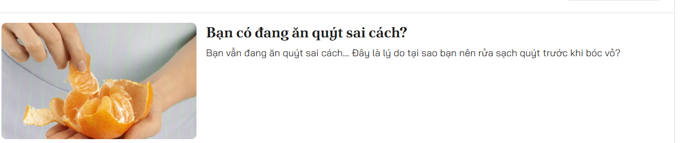
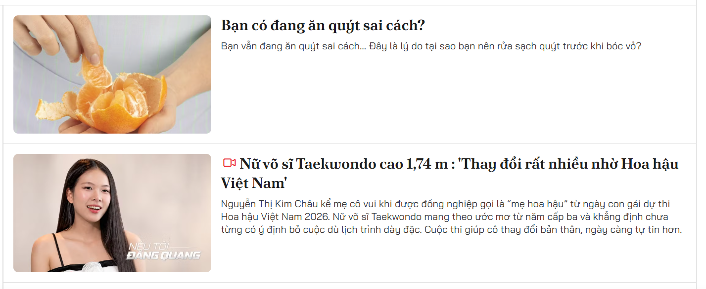
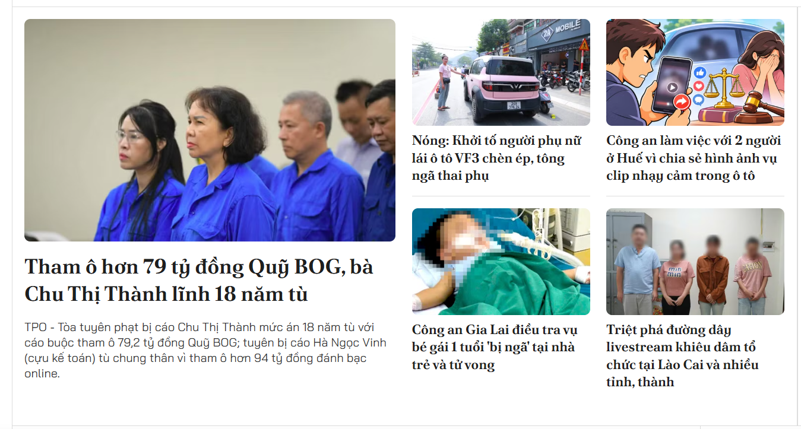
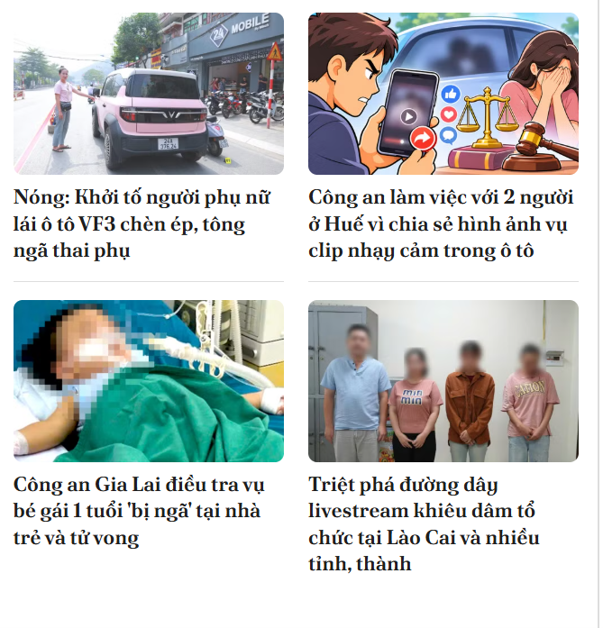
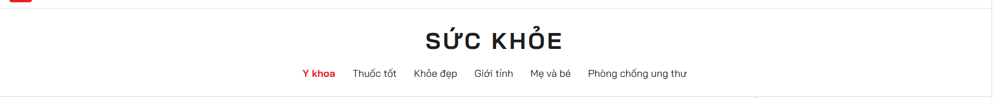
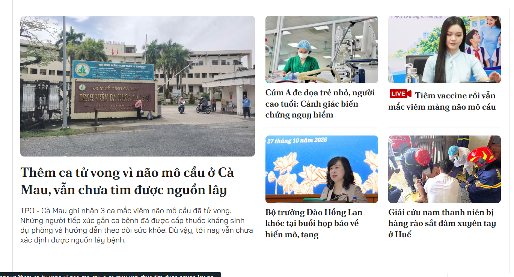
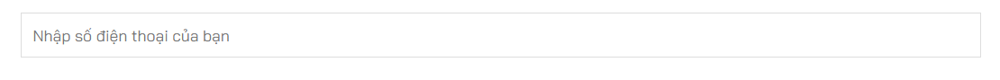
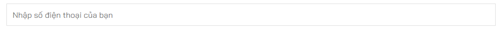

Nhóm components/layout/ — khung trang

| File           | Ý nghĩa        | Tác dụng                                                                          |
| -------------- | -------------- |-----------------------------------------------------------------------------------|
| Header.tsx     | Đầu trang      | Chứa logo, thanh tìm kiếm và MainNav.                                             |
| MainNav.tsx    | Menu chính     | Hiển thị các chuyên mục cấp 1: Xã hội, Kinh tế, Thế giới, Thể thao, Văn hoá…      |
| MegaMenu.tsx   | Menu nhiều cấp | Khi hover “Kinh tế”, hiện Thị trường, Doanh nghiệp, Đầu tư, Tài chính – Chứng khoán. |
| Footer.tsx     | Chân trang     | Chứa giới thiệu, liên kết chuyên mục, thông tin bản quyền và nguồn dữ liệu RSS.   |
| ContentContainer.tsx    | Khung của 1 trang | Đọc dọc từ trên xuống dưới và sắp xếp các component |
| SearchBox.tsx    | Ô tìm kiếm        | Nhập từ khoá và chuyển sang /tim-kiem?q=....        |

# Header

# MainNav & MegaMenu

# Footer

Nhóm components/article/ — hiển thị bài viết

| File                | Ý nghĩa                | Tác dụng                                                                          |
| ------------------- |------------------------|-----------------------------------------------------------------------------------|
| CompactArticleList.tsx     | Thẻ một bài viết       | Hiển thị ảnh, tiêu đề, dùng ở mọi trang.                                          |
| FeaturedArticleList.tsx | Bài tiêu biểu          | Bài có ảnh lớn, tiêu đề nổi bật; có nội dung tóm tắt.                             |
| ArticleList.tsx | Bài dành cho danh sách | Bài có ảnh, tiêu đề nổi bật; có nội dung tóm tắt nhưng ảnh bên trái chữ bên phải. |

# CompactArticleList

# FeaturedArticleList

# ArticleList

Nhóm components/category/ — chuyên mục

| File               | Ý nghĩa                   | Tác dụng                                                                  |
| ------------------ | ------------------------- | ------------------------------------------------------------------------- |
| CategoryHeader.tsx | Đầu trang chuyên mục      | Hiện tên chuyên mục, mô tả ngắn và ảnh nền nếu có.                        |
| CategoryTabs.tsx   | Tab chuyển nhanh          | Ví dụ trong “Sức khỏe”: Y khoa, Thuốc tốt, Khỏe đẹp, Giới tính, Mẹ và bé. |

# CategoryHeader & CategoryTabs

Nhóm components/section/ — các khối chứa tin tức

| File                  | Ý nghĩa                                  | Tác dụng                                                                        |
| --------------------- |------------------------------------------|---------------------------------------------------------------------------------|
| FeaturedSection.tsx       | Khu vực tin nổi bật                      | Kết hợp 1 bài lớn và 3–5 bài phụ.                                 |
| CategorySection.tsx | Khối chuyên mục                          | Mỗi khối lấy 4–6 bài từ một chuyên mục, ví dụ “Kinh tế”, “Thể thao”, “Giải trí”. |
| ArticleGrid.tsx     | Danh sách bài sắp xếp theo cấu trúc bảng | Bảng có thể 1 cột nhiều cột, 1 hàng hay nhiều hàng                              |

# FeaturedSection

# CategorySection

# ArticleGrid

# assets : nơi chứa ảnh, vid,...
# style: nơi chứa file css ( chỉ dùng duy nhất 1 file global chung cho toàn bộ)
# lib: nơi chứa thư viện rss (đề sau chưa tính tới)
# app : nơi định nghĩa các trang và đường dẫn URL 
# pages: nơi chứa 4 trang hoàn chỉnh